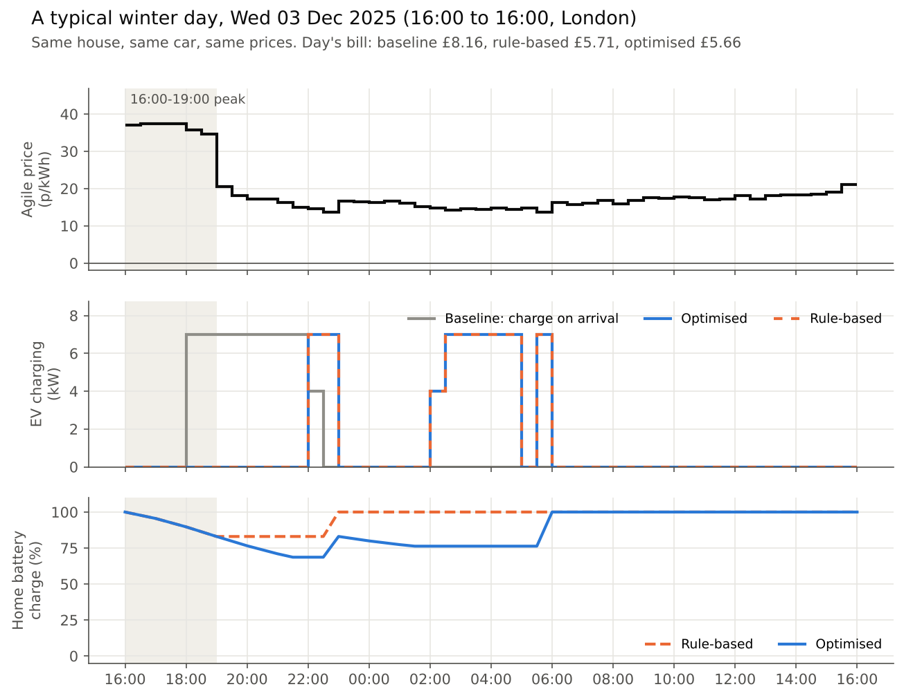
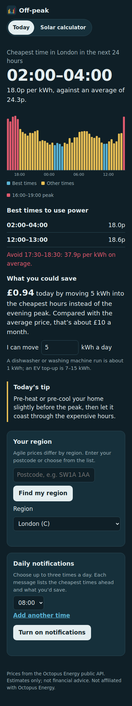

# Agile flex: scheduling an EV and a home battery on Octopus Agile prices

An optimiser that plans a London household's EV charging and home battery half-hour by half-hour against **12 months of real Octopus Agile prices** (Nov 2025 to Oct 2026, region C), then measures cost, carbon and peak load against two simpler strategies. The same engine runs a **daily planner** and powers **Off-peak**, a web app that tells people when electricity is cheapest.



| | Baseline<br><sub>charge on arrival, no battery</sub> | Optimised<br><sub>daily MILP, EV + 10 kWh battery</sub> |
|---|---:|---:|
| **Annual electricity bill** | £3,591 | **£2,142 (−40%, £1,449 saved)** |
| **Imported in the 16:00–19:00 peak** | 3,059 kWh | **4 kWh (3,055 kWh shifted)** |
| **Emissions** | 2,233 kgCO2 | **1,744 kgCO2 (−22%, 489 kg saved)** |

Even when it has to plan on a **price forecast** instead of the real prices, it keeps **92%** of that saving.

**In this repo**

| | What it does | Run it |
|---|---|---|
| [Back-test](#results-all-strategies-1-nov-2025--31-oct-2026-364-daily-plans) | Replays a year of real prices through three strategies and a forecast study | `python -m agileflex backtest` |
| [Daily planner](#daily-planner) | Every afternoon on GitHub Actions, writes tonight's charging plan to [`plans/latest.md`](plans/) | `python -m agileflex plan` |
| [Off-peak web app](#off-peak-web-app) | Cheapest times for any region, browser notifications, solar calculator, energy guides. **[Live demo](https://agile-flex-offpeak.onrender.com)** | `uvicorn webapp.main:app` |

---

## Results, all strategies (1 Nov 2025 – 31 Oct 2026, 364 daily plans)

| | Baseline | Rule-based | **Optimised** | Optimised, EV only | Optimised + carbon |
|:--|--:|--:|--:|--:|--:|
| Annual cost (£) | 3,591 | 2,295 | **2,142** | 2,409 | 2,145 |
| Saving vs baseline | – | 36.1% | **40.4%** | 32.9% | 40.3% |
| Cost per kWh used (p) | 26.4 | 16.9 | **15.7** | 17.7 | 15.8 |
| Emissions (kgCO2) | 2,233 | 1,827 | **1,744** | 1,851 | 1,701 |
| kWh moved out of 16:00–19:00 | – | 3,059 | **3,055** | 2,548 | 3,054 |
| Negative-price half-hours used (of 499) | 1 | 106 | **269** | 75 | 269 |
| kWh bought at negative prices | 4 | 304 | **658** | 252 | 657 |
| Battery throughput (kWh) | – | 511 | **2,835** | – | 2,844 |

Full table: [`outputs/metrics.csv`](outputs/metrics.csv). Monthly view: [`outputs/monthly_cost.png`](outputs/monthly_cost.png).

**What the numbers say**

- **Most of the value is not charging the car at 18:00.** Smart EV charging alone saves £1,182 a year (33%). A one-line "cheapest slots" rule gets 90% of what the optimiser finds.
- **The optimiser earns its extra £153 a year over the rule by using the battery all day**, not just at the peak: ~280 cycles a year against intraday spreads, and 2.5× as many negative-price half-hours used. In total the battery adds £267 a year on top of smart EV charging.
- **Cheap and clean mostly coincide.** Cost-only optimisation already cuts emissions 22%. A carbon weight of 15p/kgCO2 saves a further 44 kg for £2.81 a year (about £64/tonne).
- **Forecasting is worth real money, and a simple model goes far.** Committing each plan before tomorrow's prices are published, on a ridge-regression forecast (MAE 4.1p/kWh), loses £99 over 307 days vs perfect foresight and keeps 92% of the saving. Naively repeating yesterday's prices keeps 88%. The forecast-driven optimiser still beats the rule-based strategy running on *real* prices (£1,970 vs £2,018 on the same days).
- Prices moved a lot during the year: Agile averaged ~18p/kWh last winter and 25–27p/kWh in Aug–Oct 2026, which is why autumn bills are the highest in the monthly chart.

## The three strategies

1. **Baseline.** The EV charges at 7 kW from 18:00 until it has 30 kWh. No battery.
2. **Rule-based.** The EV charges in the cheapest half-hours between 18:00 and 07:30. The battery discharges into the home during 16:00–19:00, then refills in the cheapest remaining half-hours.
3. **Optimised.** A mixed-integer linear program per day ([`agileflex/optimise.py`](agileflex/optimise.py)), minimising cost plus an optional carbon weight:

```
minimise   Σ_t (price_t + w · carbon_t) · grid_t
subject to grid_t = house_t + ev_t + charge_t − discharge_t ≥ 0      (no export)
           0 ≤ ev_t ≤ 3.5 kWh while plugged in, else 0               (7 kW charger, 18:00–07:30)
           Σ_t ev_t = 30 kWh                                         (car ready by 07:30)
           0 ≤ charge_t ≤ 2.5·m_t,  0 ≤ discharge_t ≤ 2.5·(1−m_t)    (5 kW, never both, m_t binary)
           soc_t = soc_{t−1} + η·charge_t − discharge_t / η          (η = √0.9, 90% round trip)
           0 ≤ soc_t ≤ 10 kWh,  soc_end ≥ soc_start                  (no free energy)
```

Each back-test plan runs **16:00 to 16:00**: Octopus publishes the next day's Agile prices around 16:00, so this is the earliest moment a real controller knows every price in the window. Each day solves in a few hundredths of a second with CBC (bundled with PuLP). A 0.01p/kWh throughput cost breaks ties so the battery doesn't make pointless micro-moves.

## Assumptions

All live in [`config.yaml`](config.yaml); change a number and re-run.

| | Value |
|---|---|
| EV | 60 kWh battery, 7 kW charger, needs 30 kWh/day, plugged in 18:00–07:30 every day |
| Home battery | 10 kWh, 5 kW charge/discharge, 90% round-trip efficiency, full at 16:00 and restored by 16:00 next day |
| Household load (excl. EV) | 2,700 kWh/yr (Ofgem typical), synthetic half-hourly shape with evening peak, ±20% seasonal swing. Swap in a real profile with `house.profile_csv` |
| Tariff | Agile Octopus `AGILE-24-10-01`, region C (London), unit rates incl. VAT. Standing charge excluded (identical across strategies) |
| Export | None. The battery can only supply the home and the car |
| Carbon | National Grid ESO Carbon Intensity API, London region (id 13), half-hourly forecast intensity |
| Not modelled | Battery degradation (so battery value is an upper bound), EV charging losses, days the car is away |

---

## Daily planner

Every afternoon, once Octopus publishes tomorrow's prices, a free GitHub workflow runs the same optimiser for tonight's window (18:00 → 18:00) and commits the plan to [`plans/latest.md`](plans/): when to charge the car, when to charge and use the battery, the best and worst hours for flexible appliances, any negative-price windows, and a running total of estimated savings. The battery level the plan expects at the end of the day is carried into the next day's plan.

```
# Charging plan: Wed 03 Dec 18:00 → Thu 04 Dec 18:00

Estimated cost for the day (home + car): £5.35, against £9.52 if the car charged as
soon as it was plugged in. Saving: £4.17 (44%).

## Car: 30 kWh needed by 07:30
- Charge 18:00–19:00, 3.9 kWh (from the home battery)
- Charge 00:00–04:00, 26.1 kWh (avg 13.1p/kWh; 1.6 kWh of it from the home battery)

## Flexible appliances (washing machine, dishwasher, tumble dryer)
- Good: 12:00–15:00 (avg 15.6p)
- Avoid: 18:00–19:00 (avg 35.7p)
```
<sub>Example from test data.</sub>

**Turn it on (10 minutes):** set your region, car and battery in `config.yaml` → GitHub **Actions** tab → enable workflows → **daily-plan** → **Run workflow**. If it fails at `git push`, set **Settings → Actions → General → Workflow permissions → Read and write**. It then tries every 30 minutes from 15:17 to 21:47 UTC, because GitHub often delays or drops scheduled jobs; the first run after prices are out commits the plan and later runs stop in seconds. A plan made after 18:00 starts from the next half-hour. GitHub pauses scheduled workflows on repos with no activity for 60 days; re-enable from the Actions tab if that happens.

## Off-peak web app

**[Try Off-peak live →](https://agile-flex-offpeak.onrender.com)** <sub>(free hosting: if nobody has visited for a while, the first load takes up to a minute while it wakes up)</sub>

[](https://agile-flex-offpeak.onrender.com)

`webapp/` is a small FastAPI app for anyone on Agile, not just EV owners:

- **Cheapest times** for the next 24 hours in any region (or by postcode), the time to avoid, negative-price windows and an estimated saving for the kWh you can shift.
- **Browser notifications** at up to three times a day you choose. `.github/workflows/send-notifications.yml` calls `/api/tasks/send-due` every 30 minutes; each message is sent once, skipped if more than two hours late, and revoked browsers are removed.
- **Solar and battery calculator** (`/api/solar`) and six **energy guides** at `/guides` (Markdown files in `webapp/articles/`; add a file and it appears).

**Run it locally**

```bash
python scripts/generate_vapid_keys.py     # run the three export lines it prints
export CRON_TOKEN=any-long-random-string
uvicorn webapp.main:app --reload          # open http://127.0.0.1:8000
```

The live demo runs on Render's free tier with notifications switched off; turning them on needs a database and VAPID keys (task 1 in [TASKS.md](TASKS.md)). Locally it stores subscribers in a SQLite file. Browsers allow notifications on `localhost`; in production they need HTTPS, and on iPhone the site must be added to the Home Screen first (iOS 16.4+). To deploy for free, see task 1 in [TASKS.md](TASKS.md) ([`render.yaml`](render.yaml) sets up the Render service; you add a Postgres URL, the VAPID keys and `CRON_TOKEN`).

| Endpoint | Purpose |
| --- | --- |
| `GET /api/advice?region=C&shift_kwh=5` | Cheapest times, savings and tip for the next 24 hours |
| `GET /api/region?postcode=SW1A1AA` | Postcode to Agile region |
| `POST /api/subscribe`, `/api/unsubscribe`, `/api/test-push` | Browser notification management |
| `POST /api/solar` | Solar and battery savings estimate |
| `POST /api/tasks/send-due` | Sends due notifications (needs `X-Cron-Token`) |
| `GET /guides`, `/guides/{slug}`, `/api/articles` | Energy guides |
| `GET /api/docs` | Interactive API documentation |

---

## Run it

```bash
git clone https://github.com/omlettehead22/Agile-Flex-Optimiser && cd Agile-Flex-Optimiser
python -m venv .venv && source .venv/bin/activate     # Windows: .venv\Scripts\activate
pip install -r requirements.txt
pytest -q                          # 67 tests, ~45 s
python -m agileflex backtest       # ~1 min: all strategies, metrics, charts, forecast study -> outputs/
python -m agileflex plan           # tonight's plan -> plans/ (after ~16:00 UK time)
```

The year of data is cached in `data/`, so the back-test needs no network. To change region or period, edit `config.yaml` and run `python -m agileflex fetch --refresh` (no API key required). For a step-by-step tour, `pip install jupyter` and open [`notebooks/walkthrough.ipynb`](notebooks/walkthrough.ipynb).

## Project layout

| Path | Purpose |
|---|---|
| `agileflex/common.py` | Config, data loading, household profile, DST-safe planning windows |
| `agileflex/fetch.py` | Octopus and Carbon Intensity APIs. Finds the current Agile product automatically, since product codes change |
| `agileflex/strategies.py` | Baseline and rule-based strategies |
| `agileflex/optimise.py` | The daily MILP, shared by the back-test, the planner and the forecast study |
| `agileflex/forecast.py` | Walk-forward ridge price forecaster |
| `agileflex/report.py` | Back-test metrics, charts, `outputs/results.json` |
| `agileflex/planner.py` | Daily plan: tomorrow's prices → `plans/latest.md` |
| `webapp/` | Off-peak: FastAPI app, notifications, solar calculator, guides, static front end |
| `.github/workflows/` | `tests` on every push · `daily-plan` each afternoon · `send-notifications` every 30 min |
| `tests/` | Every strategy on real days, DST days and adversarial prices (all-negative, flat, spikes): EV always reaches its target only while plugged in; battery stays within power and SOC limits, never charges and discharges at once, follows the loss model and ends the day where it started; no export; optimiser never beaten by the heuristics; a carbon weight never increases emissions. Plus the planner, API parsing and the web app |
| `TASKS.md` | Roadmap for the web app |

## Data notes

- Agile: 17,520 half-hours, no gaps. 499 negative-price half-hours, minimum −11.3p, maximum 86.7p.
- Carbon intensity: the API has no London data for 1–2 Jan 2026 (95 half-hours). These are filled with the average for the same half-hour over the surrounding ±9 days and flagged in the `interpolated` column.
- The tests caught a real bug during development: adding 24 hours to a timezone-aware timestamp drifts by an hour after the clocks change, which silently moved every summer plan to 17:00. Windows are now built from local calendar dates.

## Limitations and next steps

- The plan is advice: it doesn't switch the charger or battery. Many chargers and batteries expose an API, which would turn it into automation.
- No export. Adding Agile Outgoing prices would let the battery sell at the peak.
- The car needs the same energy every day; real driving varies.
- Home load is a typical profile, not a measurement. Octopus customers can pull their own half-hourly usage with an API key.
- Scale: optimising 1,000 homes under a shared local grid limit is the flexibility problem suppliers solve for real.

## Data sources

- Octopus Energy public API: `https://api.octopus.energy/v1/products/` → `…/electricity-tariffs/E-1R-AGILE-24-10-01-C/standard-unit-rates/`
- Carbon Intensity API (National Grid ESO): `https://api.carbonintensity.org.uk/regional/intensity/{from}/{to}/regionid/13`

Not affiliated with Octopus Energy. MIT licence.
