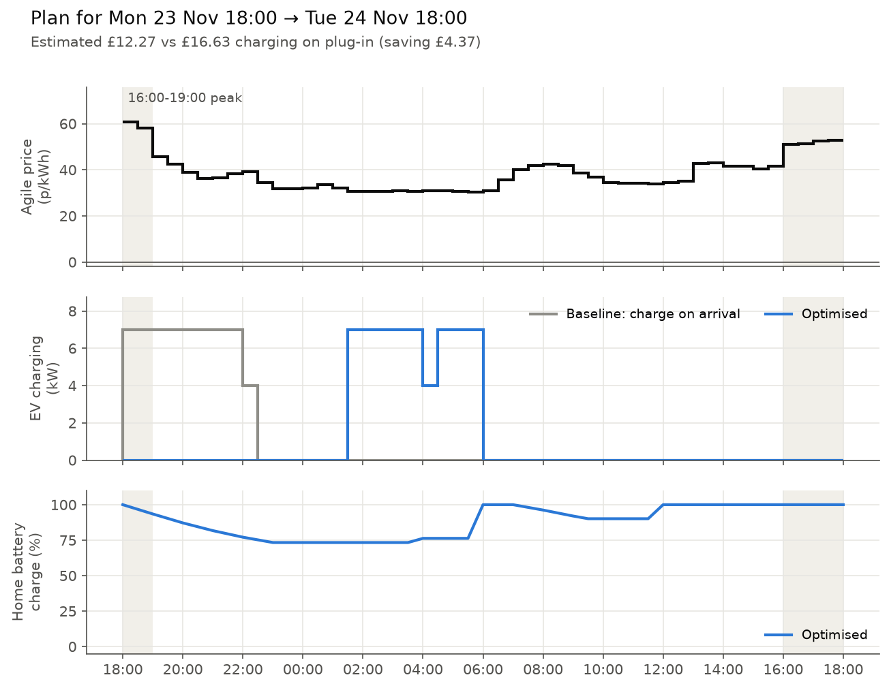

# Charging plan: Mon 23 Nov 18:00 → Tue 24 Nov 18:00

**Estimated cost for the day (home + car): £12.27**, against £16.63 if the car charged as soon as it was plugged in. **Saving: £4.37 (26%).**

Tariff E-1R-AGILE-24-10-01-C · generated 23 Nov 16:16 UK time

## Car: 30 kWh needed by 07:30

- Charge **01:30–06:00**, 30.0 kWh (avg 30.7p/kWh)

## Home battery

- Charge **03:30–04:00**, 0.3 kWh
- Charge **05:30–06:00**, 2.5 kWh
- Charge **11:30–12:00**, 1.0 kWh
- Power the home (and car) **18:00–23:00**, 2.5 kWh
- Power the home (and car) **07:00–09:30**, 0.9 kWh

## Flexible appliances (washing machine, dishwasher, tumble dryer)

- Good: **10:00–13:00** (avg 34.3p)
- Avoid: 18:00–19:00 (avg 59.3p)

## Prices

Cheapest 30.3p at 05:30 · most expensive 60.7p at 18:00 · average 38.4p/kWh

## Running total

Saved **£27.24** over 13 planned day(s) since 11 Nov 2026, compared with charging on plug-in.

