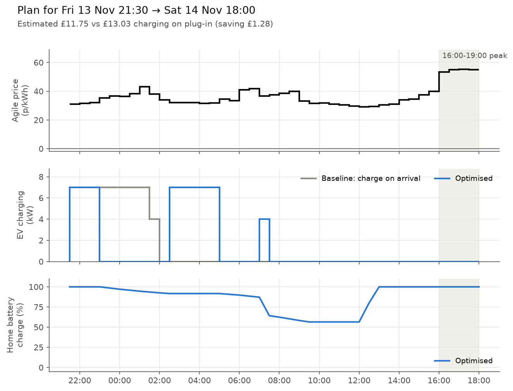

# Charging plan: Fri 13 Nov 21:30 → Sat 14 Nov 18:00

**Estimated cost for the day (home + car): £11.75**, against £13.03 if the car charged as soon as it was plugged in. **Saving: £1.28 (10%).**

Tariff E-1R-AGILE-24-10-01-C · generated 13 Nov 21:26 UK time

> Planned late, at 21:26, so this plan starts at 21:30 instead of 18:00.

## Car: 30 kWh needed by 07:30

- Charge **21:30–23:00**, 10.5 kWh (avg 31.6p/kWh)
- Charge **02:30–05:00**, 17.5 kWh (avg 31.9p/kWh)
- Charge **07:00–07:30**, 2.0 kWh (from the home battery)

## Home battery

- Charge **12:00–13:00**, 4.6 kWh
- Power the home (and car) **23:00–02:30**, 0.8 kWh
- Power the home (and car) **05:00–09:30**, 3.3 kWh

## Flexible appliances (washing machine, dishwasher, tumble dryer)

- Good: **11:00–14:00** (avg 30.0p)
- Avoid: 16:30–17:30 (avg 55.1p)

## Prices

Cheapest 29.1p at 12:00 · most expensive 55.2p at 17:00 · average 36.4p/kWh

## Running total

Saved **£10.31** over 3 planned day(s) since 11 Nov 2026, compared with charging on plug-in.

